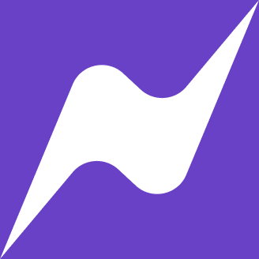

# NAITIK - Dark Pattern Buster

<div align="center">
  
  <br>
  <em>A comprehensive dark pattern detection and prevention system</em>
</div>

## 📋 Table of Contents
- [Overview](#overview)
- [Features](#features)
- [Architecture](#architecture)
- [Project Structure](#project-structure)
- [Setup Instructions](#setup-instructions)
- [Usage](#usage)
- [API Documentation](#api-documentation)
- [Contributing](#contributing)
- [License](#license)

## 🎯 Overview

NAITIK is an advanced dark pattern detection system designed to identify and prevent deceptive user interface patterns commonly used by websites to manipulate user behavior. The system combines machine learning, web scraping, and browser extension technology to provide comprehensive dark pattern detection.

### Project Documentation
For detailed project information, please refer to our comprehensive documentation:
- [NAITIK Project Documentation](naitik_kaleidocrew.pdf)

## ✨ Features

### 🔍 Dark Pattern Detection
- **Multi-class Classification**: Detects various types of dark patterns including:
  - Forced Action
  - Misdirection
  - Obstruction
  - Scarcity
  - Sneaking
  - Social Proof
  - Urgency
- **Real-time Analysis**: Instant detection of dark patterns on web pages
- **Machine Learning Model**: Uses fine-tuned transformer models for accurate classification

### 🌐 Web Scraping & Monitoring
- **E-commerce Integration**: Supports Amazon and Flipkart scraping
- **Price Monitoring**: Tracks price changes and identifies fake discounts
- **Review Analysis**: Detects fake reviews using sentiment analysis
- **Automated Reporting**: Generates comprehensive reports on detected patterns

### 🛡️ Browser Extension
- **Chrome Extension**: Real-time dark pattern detection while browsing
- **Visual Indicators**: Highlights potential dark patterns on web pages
- **User Alerts**: Warns users about detected deceptive patterns

### 📊 Admin Dashboard
- **Analytics Dashboard**: Comprehensive overview of detected patterns
- **Data Visualization**: Charts and graphs for pattern analysis
- **Review Management**: Approve/reject reported dark patterns
- **Monitoring Tools**: Real-time system monitoring

## 🏗️ Architecture

```
┌─────────────────┐    ┌─────────────────┐    ┌─────────────────┐
│   Chrome        │    │   Admin         │    │   Backend       │
│   Extension     │◄──►│   Dashboard     │◄──►│   Services      │
│   (naitik_mini) │    │   (admin/)      │    │   (scrapers/)   │
└─────────────────┘    └─────────────────┘    └─────────────────┘
                                │                       │
                                ▼                       ▼
                       ┌─────────────────┐    ┌─────────────────┐
                       │   LLM Service   │    │   Database      │
                       │ (darkpatternLLM)│    │   (dark.db)     │
                       └─────────────────┘    └─────────────────┘
```

## 📁 Project Structure

```
naitik/
├── admin/                 # React-based admin dashboard
├── naitik_mini/          # Chrome extension (TypeScript + Vite)
├── scrapers/             # Backend API and scraping services
├── darkpatternLLM/       # Machine learning model service
├── docs/                 # Project documentation and assets
├── images/               # Static images and logos
└── docker-compose.yml    # Docker configuration
```

## 🚀 Setup Instructions

### Prerequisites
- Node.js (v16 or higher)
- Python 3.8+
- Chrome browser (for extension)
- Docker (optional)

### 1. Admin Dashboard Setup

```bash
cd admin
npm install
npm start
```

The admin dashboard will be available at `http://localhost:3000`

### 2. Chrome Extension Setup

```bash
cd naitik_mini
npm install
npm run build
```

To load the extension:
1. Open Chrome and go to `chrome://extensions/`
2. Enable "Developer mode"
3. Click "Load unpacked" and select the `dist` folder from `naitik_mini/`

### 3. Backend Services Setup

#### Scrapers Service
```bash
cd scrapers
pip install -r requirements.txt
python main.py
```

#### LLM Service
```bash
cd darkpatternLLM
pip install -r requirements.txt
python app.py
```

### 4. Docker Setup (Optional)

```bash
docker-compose up -d
```

## 📖 Usage

### Using the Chrome Extension
1. Install the extension following the setup instructions above
2. Browse any website normally
3. The extension will automatically detect and highlight potential dark patterns
4. Click on highlighted elements to see detailed analysis

### Using the Admin Dashboard
1. Access the dashboard at `http://localhost:3000`
2. View analytics and reports on detected dark patterns
3. Manage user reports and system monitoring
4. Configure detection parameters

### API Endpoints

#### Dark Pattern Detection
```bash
POST /checkdarkpattern
Content-Type: application/json

{
  "text": "Limited time offer! Only 2 left in stock!"
}
```

#### Web Scraping
```bash
POST /search
Content-Type: application/json

{
  "url": "https://amazon.com/product/123"
}
```

#### Report Management
```bash
POST /report
Content-Type: application/json

{
  "website": "example.com",
  "pattern": "urgency",
  "description": "Fake countdown timer"
}
```

## 🔧 Configuration

### Environment Variables
Create a `.env` file in the respective directories:

```env
# For darkpatternLLM/app.py
TOKEN=your_huggingface_token

# For scrapers/main.py
DATABASE_URL=sqlite:///dark.db
```

### Database Setup
The system uses SQLite by default. The database will be automatically created with the following tables:
- `darkpatterns`: Stores detected dark patterns
- `trainingdata`: Training data for ML models
- `model`: Model performance metrics
- `price`: Price tracking data

## 🤝 Contributing

1. Fork the repository
2. Create a feature branch (`git checkout -b feature/amazing-feature`)
3. Commit your changes (`git commit -m 'Add some amazing feature'`)
4. Push to the branch (`git push origin feature/amazing-feature`)
5. Open a Pull Request

## 📄 License

This project is licensed under the MIT License - see the [LICENSE](LICENSE) file for details.

## 🙏 Acknowledgments

- **Kaleido Crew**: Project development team
- **Hugging Face**: For providing the transformer models
- **Open Source Community**: For various libraries and tools used

## 📞 Support

For support and questions:
- Create an issue in the repository
- Contact the development team
- Refer to the project documentation

---

<div align="center">
  <p><strong>NAITIK</strong> - Making the web a safer place, one pattern at a time.</p>
</div>